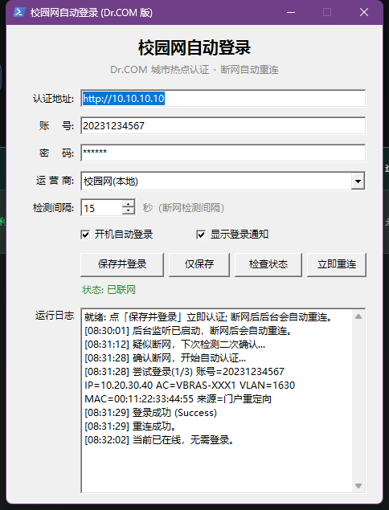

# 校园网自动登录（Dr.COM 版）

**Windows 双击即用**的 Dr.COM 校园网自动登录 / 断网自动重连工具。
图形界面版 + 命令行版，共用同一份配置，不依赖任何第三方组件。

[](https://github.com/pyyyQWQ/campus-autologin/releases/latest)
[](https://github.com/pyyyQWQ/campus-autologin/releases)
[](LICENSE)




## 下载

不想折腾源码的话，直接下载 exe：

| 文件 | 适合谁 | 说明 |
| --- | --- | --- |
| **`campus-autologin-gui.exe`** | 只想点几下就能用，**推荐** | 无控制台窗口 |
| `campus-autologin.exe` | 想放进计划任务、或配合其他脚本 | 保留控制台窗口 |
| `campus-autologin-1.0.0.zip` | 想要完整源码 + 文档 + 图标 | 全量包 |

- 下载地址：[**Releases**](https://github.com/pyyyQWQ/campus-autologin/releases/latest)，或克隆仓库后直接跑 `dist/` 里的 exe。
- 两个 exe 都由 [ps2exe](https://github.com/MScholtes/PS2EXE) 从对应 `.ps1` 打包而来，逻辑完全一致，**双击运行，不用装东西、不用改执行策略**。
- exe 没有代码签名，SmartScreen / 部分杀软可能提示「未知发布者」甚至误报 —— 这是所有自打包 PowerShell 程序的通病。
  介意就用 `.ps1` 源码，或用 `build-exe.ps1` 自己重新打包一份。

## 功能特性

- **双击即用**：图形界面版填好认证地址 / 账号 / 密码，点「保存并登录」就完事
- **断网自动重连**：默认每 15 秒探测一次，连续 2 次确认离线才动作，避免网络抖动误判
- **关窗不退出**：窗口关掉只是缩到托盘，继续在后台盯着网络
- **免维护认证参数**：自动从门户重定向里读取 `wlanuserip / wlanacname / vlan / mac`，换 AP、换校区都不用改配置
- **自动挑网卡**：多网卡环境（VPN、虚拟机、Radmin 等）下自动选中校园网卡
- **密码不留明文**：用 Windows DPAPI 加密保存，配置文件里看不到密码原文
- **开机自启**：图形版勾选「开机自动登录」即可；命令行版优先注册计划任务
- **零依赖**：Windows 自带 PowerShell 5.1 就能跑

## 适用 / 不适用

**适用**：Dr.COM 的 Web 门户，登录接口是 `/quickauth.do`，且门户返回的配置里 `authByRas=false`（明文参数认证）。

判断方法：连上校园网后打开门户登录页，查看网页源码，能看到 `InitPortalConfig`、`portalUtil.js`、`/quickauth.do` 这类特征，基本就适用。

**不适用**（需要自行改造）：

- 门户开启了 RSA（`authByRas=true`）—— 参数需按门户的 `encryptParam` 加密后再提交
- 登录需要图形验证码（`listpasscode`）
- 根本不是 Dr.COM 门户（华为 AC portal、锐捷 ePortal、深澜 Srun 等）

## 图形界面版

双击 `campus-autologin-gui.exe` 打开窗口，填好认证地址 / 账号 / 密码，点「保存并登录」即可。

| 操作 | 说明 |
| --- | --- |
| 保存并登录 | 保存配置（密码 DPAPI 加密存储）并立即认证一次 |
| 仅保存 | 只保存配置，不发起登录 |
| 检查状态 | 显示当前是否联网、选用哪块网卡、将要提交的认证参数 |
| 立即重连 | 强制认证一次（用于排错） |
| 开机自动登录 | 勾选后在启动文件夹生成快捷方式，开机自动缩到托盘、静默重连 |
| 显示登录通知 | 登录 / 重连成功时弹托盘气泡提醒 |

关掉窗口**不会退出**程序，而是缩到托盘继续后台重连；要彻底退出请右键托盘图标 → 退出。

## 命令行 / 脚本版

```powershell
# 1) 配置向导（生成 campus-autologin.config.json，密码默认 DPAPI 加密）
powershell -NoProfile -ExecutionPolicy Bypass -File .\campus-autologin.ps1 -Setup

# 2) 安装到 %LOCALAPPDATA%\CampusAutologin 并设置开机自启
powershell -NoProfile -ExecutionPolicy Bypass -File .\install.ps1

# 3) 看当前状态（联网状态 / 选用网卡 / 将使用的认证参数）
powershell -NoProfile -ExecutionPolicy Bypass -File "$env:LOCALAPPDATA\CampusAutologin\campus-autologin.ps1" -Status
```

也可以不进向导，直接把 `config.example.json` 复制成 `campus-autologin.config.json` 手工填写。

用 exe 版时参数完全一致：

```powershell
.\campus-autologin.exe -Setup      # 配置向导
.\campus-autologin.exe -Status     # 看状态
.\campus-autologin.exe             # 在线则退出，离线才认证（适合放进计划任务）
.\campus-autologin.exe -Watch      # 常驻监听，断网自动重连
```

## 怎么找「认证地址」

1. 连上校园网（此时还不能上网），浏览器访问任意 **http** 网站，会被跳转到门户登录页；
   地址栏里形如 `http://10.0.0.1/portal.do?wlanuserip=...&wlanacname=...` → 认证地址就是 `http://10.0.0.1`。
2. 或者在命令行执行 `ipconfig`，看该网卡的「默认网关」，通常就是门户地址。
3. 或直接问同校同学、学校网络中心。

注意：

- 只填主机，**不要带路径**（`/portal.do`）、也不要带端口，脚本会自己拼 `/quickauth.do`。
- 账号一般只填学号/手机号，后缀（如 `@cmcc`、`@telecom`）由门户自动补；确需固定后缀时用 `ispSuffix`。
- 源码里内置的默认门户只是占位示例地址，请改成你自己学校的门户地址：图形版直接改「认证地址」，命令行版在 `-Setup` 里改。

## 配置项（`campus-autologin.config.json`）

| 字段 | 说明 |
| --- | --- |
| `portalHost` | 门户地址，如 `http://10.0.0.1` |
| `userId` | 登录账号 |
| `password` / `passwordEncrypted` | 二选一。后者为 DPAPI 密文（推荐，`-Setup` 自动生成） |
| `ispSuffix` | 可选账号后缀，留空表示不处理 |
| `portalType` | 门户类型参数，默认 `0`，一般不用改 |
| `ssidPattern` | 校园网 SSID 匹配正则，用于挑选网卡，如 `校园\|CMCC\|WiFi` |
| `wlanacname` / `vlan` | 兜底参数；留空即可，脚本会从门户重定向自动获取 |
| `watchIntervalSeconds` | 监听探测间隔，默认 15 秒 |
| `offlineConfirmCount` | 连续失败几次判定离线，默认 2 |
| `showNotifications` | 图形界面版用：登录 / 重连成功时是否弹托盘通知 |
| `probeUrls` | 联网探测地址（返回 204 视为在线） |

## 常用命令

| 命令 | 作用 |
| --- | --- |
| `-Setup` | 配置向导，生成/更新配置文件 |
| `-Status` | 查看状态与将要使用的认证参数 |
| （无参数） | 在线则退出；离线才认证，适合放进计划任务 |
| `-Watch` | 常驻监听，断网自动重连 |
| `-ForceLogin -DryRun` | 只打印将要发送的请求（不回显密码），用于排错 |
| `-RegisterTask` | 注册开机自启（计划任务 → 失败则启动文件夹快捷方式） |
| `-UnregisterTask` | 删除自启项并结束监听进程 |
| 图形版 `-Tray` | `campus-autologin-gui.exe -Tray`：启动后直接缩到托盘（开机自启用的就是它） |

## 工作原理

1. 定时请求 `connect.rom.miui.com/generate_204`、`www.gstatic.com/generate_204`，返回 204 视为在线。
2. 探测失败达到 `offlineConfirmCount` 次后判定离线（防抖）。
3. 尝试从门户重定向（HTTP 302 的 `Location` 或页面里的 `...portal.do?wlanuserip=...`）解析
   `wlanuserip / wlanacname / vlan / mac`；解析不到才回退到「本机网卡 + 上次成功参数」。
4. 以 `GET {门户}/quickauth.do?userid=..&passwd=..&wlanuserip=..&wlanacname=..&vlan=..&mac=..&portaltype=..` 认证，
   返回 `{"code":"0"}` 即成功，并把本次 `wlanacname / vlan` 写入状态文件备下次使用。

## 目录结构

```text
campus-autologin/
├─ campus-autologin-gui.ps1   图形界面版源码（WinForms + 托盘）
├─ campus-autologin.ps1       命令行版源码（与图形版共用同一套引擎）
├─ build-exe.ps1              用 ps2exe 把上面两个脚本打包成 exe
├─ install.ps1                安装到 %LOCALAPPDATA% 并设置开机自启
├─ uninstall.ps1              卸载并清理自启项
├─ config.example.json        配置文件示例
├─ assets/                    图标与界面截图
└─ dist/                      预编译的 exe
```

想自己重新打包两个 exe：

```powershell
powershell -NoProfile -ExecutionPolicy Bypass -File .\build-exe.ps1
```

（会从 PSGallery 安装 `ps2exe`，仅当前用户，无需管理员），生成物直接覆盖 `dist/`。

## 卸载

```powershell
powershell -NoProfile -ExecutionPolicy Bypass -File .\uninstall.ps1
```

如果是图形界面版，卸载完记得右键托盘图标 → 退出，并删掉启动文件夹里的快捷方式。

## 常见问题

- **日志里出现 `<!DOCTYPE html>` / 「未知响应」**：说明请求打到了不存在的接口（多见于那些"老版 Dr.COM 专用工具"）。
  本脚本用的是门户自己的 `/quickauth.do`，两者不是一回事。
- **「缺少 wlanacname，无法认证」**：不在校园网内（或门户不返回重定向参数），先把配置里的 `wlanacname`/`vlan` 填上兜底值。
- **反复重复认证**：把 `offlineConfirmCount` 调大，或把 `probeUrls` 换成更稳的探测地址。
- **脚本无法运行 / 提示执行策略**：加上 `-ExecutionPolicy Bypass`，或先执行 `Set-ExecutionPolicy RemoteSigned -Scope CurrentUser`。
- **换了电脑或换了 Windows 用户后报密码解密失败**：DPAPI 密文与用户绑定，重新跑一次 `-Setup` 即可。
- **SmartScreen 提示未知发布者 / 杀软报毒**：exe 未签名，属于自打包 PowerShell 程序的常见误报；可以直接用 `.ps1` 源码，或自行打包。

## 安全与免责

- `campus-autologin.config.json`、`*.log`、`*.state.json` 含个人敏感信息，**已在 `.gitignore` 中排除，切勿提交或分享**。
- 密码使用 DPAPI 加密（`-Setup` 默认），只能在本机当前用户下解密；但脚本本身通过 HTTPS 之外的校园内网提交口令，请自行评估风险。
- 本项目仅用于**个人设备在自有账号上的自动化登录**；请先确认符合你所在学校/单位的网络管理规定，因使用产生的任何后果由使用者自负。
- 不提供批量登录、多账号、代他人认证等功能，请勿改造用于此类用途。

## License

[MIT](LICENSE)